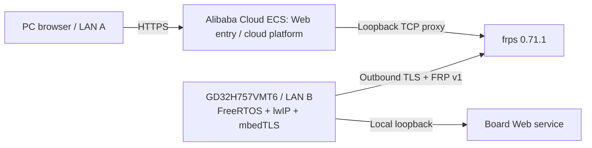

# GD32H757 FRP · Alibaba Cloud ECS

[中文](README.md) · [Firmware integration](docs/firmware.md#english) · [ECS deployment](docs/deployment.md#english) · [Validation](docs/validation.md#english) · [Provenance and licenses](NOTICE.md#english)

**An FRP v1 client adapted to GD32H757VMT6, with frps on Alibaba Cloud ECS, enabling browser access to a remote MCU across different LANs.**

Prepared by QingGuo Lv (Qinn), this project focuses on embedded protocol implementation, cloud deployment, and end-to-end integration. The original system successfully connected a PC browser, an Alibaba Cloud hosted platform, and a real GD32H757VMT6 board across different LANs. The board initiates an outbound tunnel; its LAN does not need a public inbound endpoint.

## Contributions

- Implementing a resource-constrained C client on GD32H757VMT6: login, TCP proxy registration, authenticated heartbeats, independent work connections, and bidirectional forwarding.
- Adapting FreeRTOS tasks, lwIP sockets, GD32 hardware randomness, and mbedTLS while retaining certificate chain, peer identity, and validity checks.
- Deploying and integrating frps, the HTTPS entry point, and the cloud platform on Alibaba Cloud ECS.
- Validating browser/platform/real-board connectivity across different LANs.

The FRP protocol and frps originate from [fatedier/frp](https://github.com/fatedier/frp). This is not a direct port of the official Go frpc. The published client uses FreeRTOS/lwIP/mbedTLS, unlike [xfrpc](https://github.com/liudf0716/xfrpc), which uses libevent/bufferevent and json-c. Whether xfrpc was historically consulted or adapted remains unconfirmed; see [NOTICE](NOTICE.md#english).

## Published scope

| Directory | Contents |
| --- | --- |
| `firmware/` | Extracted FRP/TLS/hardware RNG/authenticated clock code, standalone configuration and logging |
| `deploy/` | frps, systemd and Nginx templates; single-device authenticated clock/port example |
| `tools/` | Local provisioning and public-file checks |
| `tests/` | Host checks for the minimal companion and firmware authentication packets |
| `docs/` | Complete Chinese and English integration, ECS setup and validation documentation |

The communication unit's application modules, cloud account/authorization/business source, original firmware project, bootloader, business data and historical Git history are excluded. Original screenshots and live access endpoints are also excluded.

## Compatibility and quick start

The client strictly checks the **frps 0.71.1** response version and implements **FRP v1 + TCP proxy + TLS 1.2**. Set `transport.tcpMux = false` and enable token authentication for `HeartBeats` and `NewWorkConns`. The control stream uses FRP v1 PBKDF2/AES-CFB after login; TLS uses ECDHE-ECDSA/AES-128-GCM. Up to three work connections are supported. Other transports, FRP v2, compression, and full frpc compatibility are not implemented or not validated.

1. Prepare your own server, certificates, security group, frps and minimal bootstrap service using the [deployment guide](docs/deployment.md#english).
2. Run `python tools/provision.py --server 192.0.2.10 --ca /path/to/your/ca.crt`, replacing the documentation IP with your ECS IPv4. Fresh credentials are generated under ignored `private/`; do not commit them.
3. Copy the generated `cloud_demo_config.h` into `firmware/`. Follow the [firmware guide](docs/firmware.md#english), then call `cloudClientStart()` once the network and local Web service are ready.
4. Access your HTTPS endpoint from a browser on another LAN and follow the [validation procedure](docs/validation.md#english).

`192.0.2.10`, `board.example.com` and the zero-filled sample device identifier are documentation placeholders. No public online demo is provided.

## Validation boundary

Historical real-board evidence from the original system is recorded separately from checks of this extracted package. This is not a complete BSP or flashable firmware project. The standalone example has not been flashed and revalidated on hardware, so the original system's results do not establish hardware reproduction of this package. See [validation](docs/validation.md#english).

First-party code is licensed under **GPL-3.0-only**. Dependencies retain their own licenses; see [LICENSE](LICENSE) and [NOTICE](NOTICE.md#english).
