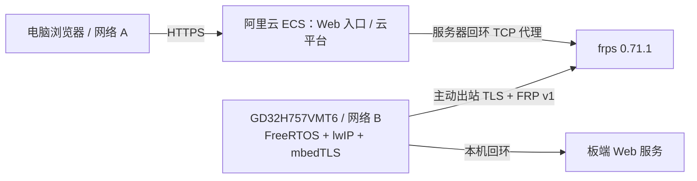

# GD32H757 FRP · Alibaba Cloud ECS

[English](README.en.md) · [平台适配](docs/firmware.md) · [ECS 部署](docs/deployment.md) · [验证记录](docs/validation.md) · [来源与许可证](NOTICE.md)

**将 FRP v1 协议适配到 GD32H757VMT6，在阿里云 ECS 部署 frps，实现电脑浏览器跨局域网访问远程 MCU 板卡。**

本项目由 QingGuo Lv（Qinn）整理，重点是嵌入式协议实现、云端部署和跨网络联调。原系统已经完成电脑浏览器 → 阿里云云平台 → GD32H757VMT6 的端到端连接测试；板卡主动建立出站隧道，无需给板卡所在局域网配置公网入口。

## 主要贡献

- 在 GD32H757VMT6 上实现受限资源环境的 C 语言 FRP 客户端：登录、TCP 代理注册、认证心跳、独立工作连接和双向转发。
- 适配 FreeRTOS 任务、lwIP Socket、GD32 TRNG 和 mbedTLS，保留证书链、目标身份及有效期验证。
- 完成阿里云 ECS 上 frps、HTTPS 入口与云端平台的部署、配置和联调。
- 在不同局域网之间完成浏览器、云平台和真实板卡的连通验证。

FRP 协议及 frps 来自 [fatedier/frp](https://github.com/fatedier/frp)。本项目并非对 Go 版官方 frpc 的直接移植，公开的板端实现使用 FreeRTOS/lwIP/mbedTLS；与使用 libevent/bufferevent、json-c 的 [xfrpc](https://github.com/liudf0716/xfrpc) 结构不同。历史上是否参考或改写过 xfrpc 尚无法确认，详见 [NOTICE](NOTICE.md)。

## 首版公开内容

| 目录 | 内容 |
| --- | --- |
| `firmware/` | 从已应用的板端模块提取的 FRP/TLS/硬件熵/认证对时实现；独立配置与日志接口 |
| `deploy/` | frps、systemd、Nginx 配置模板；单设备认证对时和端口示例 |
| `tools/` | 本地配置生成与公开文件检查 |
| `tests/` | 最小配套服务与固件认证报文的主机测试 |
| `docs/` | 完整中英文平台适配、ECS 配置和验证说明 |

通信管理机的业务模块、云平台账户/授权/业务源码、原固件工程、Bootloader、业务数据和历史 Git 记录不在此仓库。原始截图与在线访问地址也不发布。

## 兼容范围与快速开始

当前客户端严格检查 **frps 0.71.1** 的版本响应，使用 **FRP v1 + TCP 代理 + TLS 1.2**。服务端必须设置 `transport.tcpMux = false`，并启用 `HeartBeats`、`NewWorkConns` token 认证。控制流登录后使用 FRP v1 所需的 PBKDF2/AES-CFB；TLS 使用 ECDHE-ECDSA/AES-128-GCM。最多三条工作连接。其他协议、FRP v2、压缩和全功能 frpc 兼容性未实现或未验证。

1. 按 [ECS 部署文档](docs/deployment.md) 准备自己的服务器、证书、安全组、frps 和最小引导服务。
2. 运行 `python tools/provision.py --server 192.0.2.10 --ca /path/to/your/ca.crt`，将示例 IP 替换为自己的 ECS IPv4。生成结果在被忽略的 `private/`，包含全新凭据；不要提交。
3. 将生成的 `cloud_demo_config.h` 放入 `firmware/`，按 [固件集成文档](docs/firmware.md) 加入自己的 GD32 工程，在网络及本机 Web 服务就绪后调用 `cloudClientStart()`。
4. 在另一局域网的浏览器访问自己的 HTTPS 入口，按 [验证说明](docs/validation.md) 检查端到端数据返回。

`192.0.2.10`、`board.example.com` 和全零示例设备号均为文档占位符，没有公共在线演示服务。

## 验证边界

已应用原系统的真实板卡联调记录与本次独立提取包的检查分开记录。本仓库不是可直接烧录的完整 BSP/固件工程；独立示例没有重新烧录实板验收，不能把原系统测试等同于公开示例已完成硬件复现。详情见 [验证记录](docs/validation.md)。

首版自有代码采用 **GPL-3.0-only**；第三方依赖分别遵守各自许可证，见 [LICENSE](LICENSE) 和 [NOTICE](NOTICE.md)。
